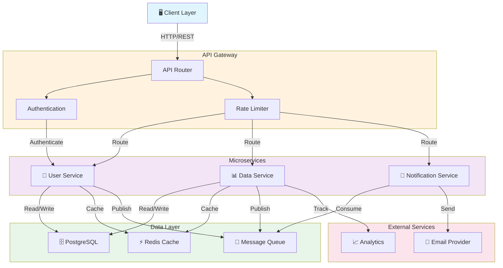

# Architecture Overview

This document provides a visual overview of the system architecture using a Mermaid diagram.

## System Architecture

## Architecture Components

### Client Layer
- Web browsers and mobile applications
- Communicates with the system via REST APIs

### API Gateway
- **API Router**: Routes incoming requests to appropriate services
- **Authentication**: Validates user credentials and tokens
- **Rate Limiter**: Prevents abuse by limiting requests per client

### Microservices
- **User Service**: Manages user accounts and profiles
- **Data Service**: Handles data storage and retrieval operations
- **Notification Service**: Sends notifications to users via email and other channels

### Data Layer
- **PostgreSQL**: Primary relational database
- **Redis Cache**: In-memory caching for frequently accessed data
- **Message Queue**: Asynchronous task processing

### External Services
- **Email Provider**: Third-party email service for sending emails
- **Analytics**: Tracking user behavior and system metrics

## Data Flow

1. **Request Flow**: Client → API Gateway → Services → Data Layer
2. **Notification Flow**: Services → Message Queue → Notification Service → Email Provider
3. **Caching Flow**: Services → Cache (Redis) for improved performance
4. **Analytics Flow**: Services → Analytics Provider for tracking

## Technology Stack

| Layer | Technologies |
|-------|--------------|
| Frontend | React, Vue.js, or Angular |
| API | Node.js, Python, or Go |
| Database | PostgreSQL, Redis |
| Messaging | RabbitMQ or Apache Kafka |
| Deployment | Docker, Kubernetes |
| Monitoring | Prometheus, Grafana |

---

*Last Updated: September 10, 2026*
